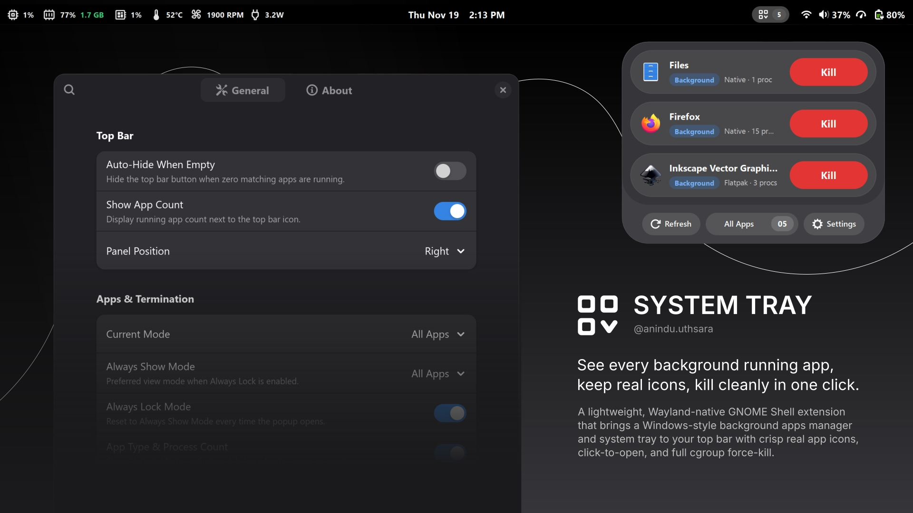

# System Tray

**Windows-style background apps & system tray for GNOME Wayland — crisp icons, instant open, total kill.**


A lightweight, Wayland-native GNOME Shell extension that brings a clean, Libadwaita-inspired background applications manager and system tray to your top panel.

---

## Preview



---

## Why System Tray?

Many desktop apps continue running in the background after closing their windows, while traditional tray extensions rely solely on legacy protocols, display blurry or monochrome icons, or consume unnecessary resources.

**System Tray** combines event-driven Linux & GNOME technologies into a minimal, responsive popup:

- **Auto-Hide Top Bar Button:** Stays hidden when no matching apps are running (optional), with a clean count badge when active.
- **Multi-Layer App Discovery:** Uses `systemd --user` cgroups (`app.slice`), `StatusNotifierWatcher` (SNI), XDG Background Portal cross-checks, and GNOME `AppSystem` — filtering out OS/system daemons automatically.
- **Crisp Real App Icons:** Prioritizes native `.desktop` vector SVG / high-DPI icons over low-resolution tray pixmaps.
- **Click-to-Open:** Click anywhere on an app card to focus or wake its window on Wayland (using valid XDG Activation tokens).
- **Full Cgroup Force Kill:** Click **Kill** to terminate the entire application cgroup and all child processes cleanly (supports both **Instant Kill** and **Safe Kill** modes, plus optional **Sure?** confirmation).
- **Two Clean Views:** Toggle between **Background** apps and **All Apps** with live process counts and smooth hidden scrolling.
- **Custom Apps Watchlist:** Add standalone AppImages, binaries, or command-line keywords from Preferences.

---

## Installation

### Option 1: GNOME Extensions Website *(Recommended)*
Install directly from [extensions.gnome.org](https://extensions.gnome.org/) once approved.

### Option 2: Manual Installation from GitHub
1. Clone this repository directly into your GNOME Shell extensions folder:
   ```bash
   git clone https://github.com/aninduuthsara/system-tray.git ~/.local/share/gnome-shell/extensions/system-tray@anindu.uthsara
   ```
2. Compile the GSettings schema:
   ```bash
   glib-compile-schemas ~/.local/share/gnome-shell/extensions/system-tray@anindu.uthsara/schemas/
   ```
3. Log out and log back in (required on Wayland for GNOME Shell to discover a newly added extension directory).
4. Enable the extension:
   ```bash
   gnome-extensions enable system-tray@anindu.uthsara
   ```

---

## Preferences

Open Extension Settings via:
```bash
gnome-extensions prefs system-tray@anindu.uthsara
```
* **General:** Configure Top Bar auto-hide, count badge, panel position, view mode (`Background` / `All Apps`), lock preferred mode, kill behavior (`Instant Kill` / `Safe Kill`), inline confirmation, and Custom Apps watchlist.
* **About:** Extension info and GitHub repository.

---

## Architecture & Resource Efficiency

* **Idle CPU:** ~0% (event-driven DBus & GNOME Shell signals; no polling timers when idle).
* **Active Refresh:** Updates live process counts every 1.5s *only* while the popup is open.
* **100% Wayland Native:** Async non-blocking I/O with zero XEmbed/X11 dependencies.

---

## Author & License

* **Author:** [Anindu Uthsara](https://github.com/aninduuthsara)
* **License:** Licensed under the **GNU General Public License v3.0 (GPL-3.0)** — see the [LICENSE](LICENSE) file for details.
